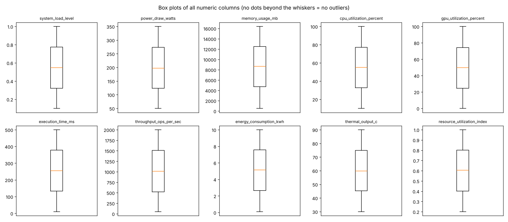

# Milestone 2: Data Understanding and Cleaning

## 1. Summary

We checked the dataset for missing values, duplicates, wrong data types, impossible values, and outliers, and documented every decision.
The data was already clean, so only two small changes were made: column names were converted to lowercase and the `id` column was dropped.
The cleaned dataset is saved in [`../data/clean_data.csv`](../data/clean_data.csv).

- **Target variable:** `efficiency_class` (3 classes)
- **Raw data:** [`../data/energy_efficient_dataset.csv`](../data/energy_efficient_dataset.csv) (7,167 rows, 12 columns)
- **Source:** *[Kaggle](https://www.kaggle.com/datasets/colabsss/energy-efficient-ai-system-performance-dataset)*

## 2. Files

| File | What it is |
|---|---|
| `cleaning_notebook.ipynb` | The cleaning notebook: every check and every decision, with outputs |
| `figures/boxplots.png` | Box plots used to check for outliers |
| `figures/target_distribution.png` | Bar chart of the target classes |
| `../data/clean_data.csv` | The clean dataset (7,167 rows, 11 columns) |

## 3. Data dictionary

The meanings below are based on the column names and the value ranges found in the data. Please confirm them against the dataset source.

| Column | Type | Meaning | Range found |
|---|---|---|---|
| `id` | integer | Row number (dropped during cleaning) | 1 to 7,167 |
| `system_load_level` | float | How busy the system is (0 = idle, 1 = full load) | 0.10 to 1.00 |
| `power_draw_watts` | float | Electrical power used, in watts | 50.0 to 349.9 |
| `memory_usage_mb` | float | Memory used, in megabytes | 516 to 16,383 |
| `cpu_utilization_percent` | float | CPU usage, in percent | 10.0 to 100.0 |
| `gpu_utilization_percent` | float | GPU usage, in percent | 0.0 to 100.0 |
| `execution_time_ms` | float | How long the task took, in milliseconds | 10.0 to 499.9 |
| `throughput_ops_per_sec` | float | Operations completed per second | 50.2 to 1,999.9 |
| `energy_consumption_kwh` | float | Energy used, in kilowatt-hours | 0.10 to 10.00 |
| `thermal_output_c` | float | Heat produced, in degrees Celsius | 30.0 to 90.0 |
| `resource_utilization_index` | float | Combined resource use score (0 to 1) | 0.20 to 1.00 |
| `efficiency_class` | text | **Target.** Efficiency level of the run | 3 classes |

## 4. Data quality results

| Check | Result |
|---|---|
| Missing values | **0** in every column |
| Duplicate rows | **0** (also 0 when `id` is ignored) |
| Data types | All 10 measurement columns are numeric. The target is text with 3 clean labels |
| Value ranges | All values are valid (percentages 0 to 100, indexes 0 to 1, no negative values) |
| Outliers (IQR rule) | **0** in all 10 numeric columns. Box plots confirm it |

**Target distribution**

| Class | Rows | Share |
|---|---|---|
| Moderate_Efficiency | 3,619 | 50.5% |
| Low_Efficiency | 2,972 | 41.5% |
| High_Efficiency | 576 | 8.0% |

## 5. Cleaning decisions and reasons

| Area | What we found | Decision | Reason |
|---|---|---|---|
| Column names | Mixed capital letters | Converted to lowercase | Consistent names, fewer typing mistakes |
| Missing values | 0 in all columns | No action | Nothing to fix |
| Duplicate rows | 0 (also 0 ignoring `id`) | No action | Nothing to remove |
| Data types | All numeric, target is text | No action | Types already match the data |
| Value ranges | All values valid, no negatives | No action | Nothing impossible found |
| Outliers | 0 by IQR rule and box plots | No capping or removal | No outliers, real values kept |
| `id` column | Unique number for every row | Dropped | No predictive information |
| Class imbalance | `High_Efficiency` is only 8% | Not changed | It is a real feature of the data, not an error |

## 6. Before and after cleaning

| Metric | Before | After |
|---|---|---|
| Rows | 7,167 | 7,167 |
| Columns | 12 | 11 |
| Missing values | 0 | 0 |
| Duplicate rows | 0 | 0 |
| Outliers (IQR rule) | 0 | 0 |
| Out-of-range values | 0 | 0 |

The summary statistics (count, mean, std, min, quartiles, max) of the 10 measurement columns are **identical** before and after cleaning.
The only change is that the `id` column was removed.

## 7. Remaining issues we chose not to fix

1. **Class imbalance.** `High_Efficiency` is only 8% of the data. This is real information, not an error. We will handle it during modeling
   (stratified split, class weights, F1-score) and never change the test data.
2. **Data looks very clean and evenly spread.** All columns are spread evenly between round minimum and maximum values, so the data may be
   synthetic or pre-cleaned. We checked this instead of assuming it.
3. **Weak signal in most features.** Average values of most features are almost the same across the three classes. Only `execution_time_ms`
   and `energy_consumption_kwh` differ clearly. We will study this in Exploratory Data Analysis.

## 8. How to run

1. Keep the repository folder structure as it is (the notebook reads `../data/energy_efficient_dataset.csv`).
2. Install the libraries: `pip install pandas numpy matplotlib`.
3. Open `cleaning_notebook.ipynb` in VS Code, select the Python kernel, and choose **Run All**.
4. The notebook creates `../data/clean_data.csv` and the charts in `figures/`.
