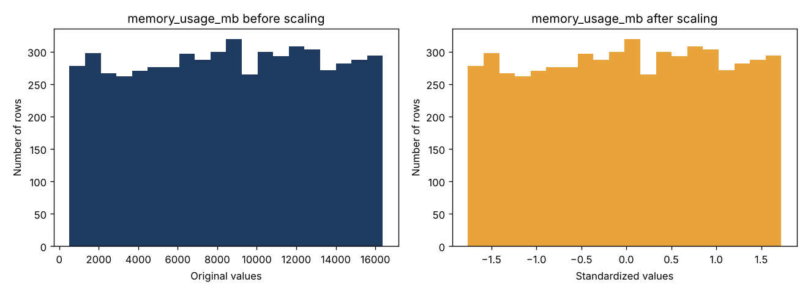
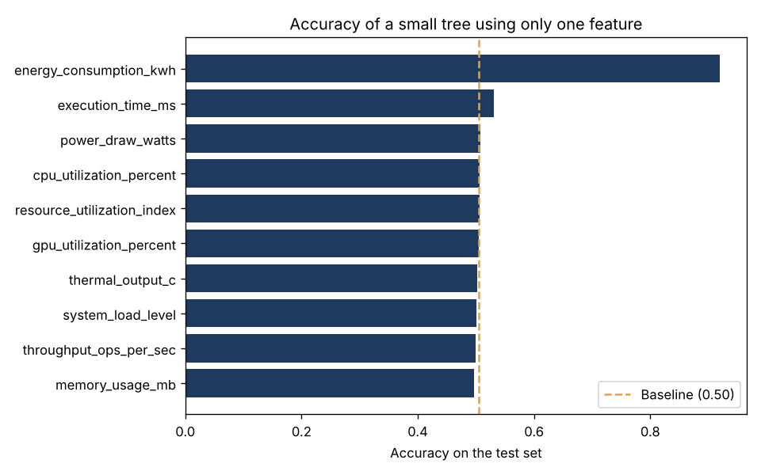
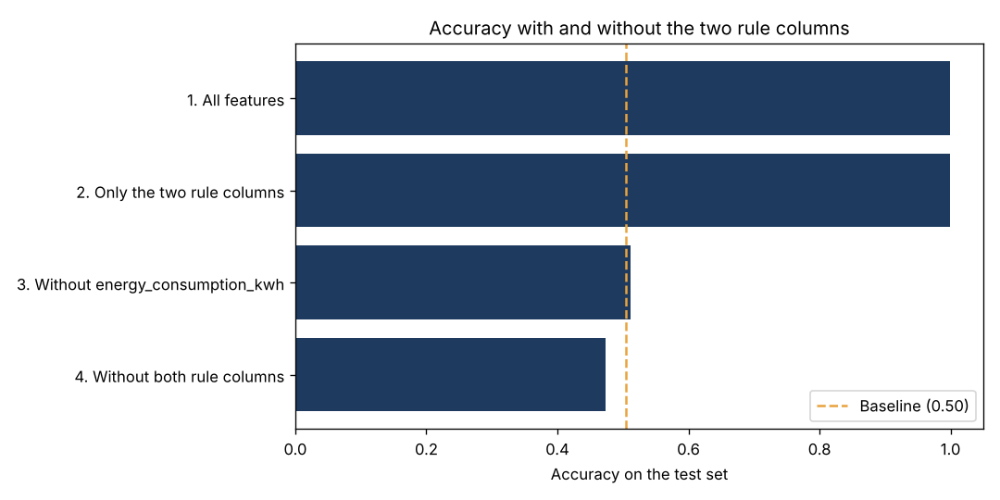

# Milestone 3: Data Preparation for Modeling

## 1. Summary

We took the clean dataset from Milestone 2 and prepared it end to end for a Machine Learning model: the target was encoded, the data was split
into train and test sets, the numeric columns were scaled using only the train set, and we ran leakage checks (7 of 7 passed).
We also found that the class is defined by a simple rule on two columns (see section 4).
The prepared data is saved in [`../data/prepared`](../data/prepared).

- **Input:** [`../data/clean_data.csv`](../data/clean_data.csv) (7,167 rows, 10 features, and the target)
- **Target variable:** `efficiency_class` (3 classes)
- **Notebook:** [`preparation_notebook.ipynb`](preparation_notebook.ipynb)

## 2. What was done

| Requirement | What we did | Why |
|---|---|---|
| Category columns are encoded correctly | Target encoded as Low = 0, Moderate = 1, High = 2. No feature needed encoding | The classes have a natural order. All 10 features are already numeric |
| Numeric columns are scaled appropriately | `StandardScaler` (mean 0, standard deviation 1) on all 10 features | Columns have very different sizes (memory in thousands, load between 0 and 1). No outliers, so standardizing is safe |
| The dataset is split into train and test sets | 80% train (5,733 rows) and 20% test (1,434 rows), `stratify` on the target, `random_state = 42` | `High_Efficiency` is only 8% of the data. Stratify keeps the same class percentages in both sets |
| No leakage exists between the two sets | The split is done **before** scaling. The scaler learns from the train set only. 7 automatic checks all passed | Test data must stay unseen, otherwise the test score is not honest |

**Other decisions**

| Area | Decision | Reason |
|---|---|---|
| Feature selection | Keep all 10 measurement columns | The highest correlation between two features is about 0.03, so none repeats another |
| Feature engineering | No new features for now | No confirmed domain rule yet. We can add features later if the model needs them |
| Validation set | Not created now | The task asks for train and test only. A validation set will be added (or cross-validation used) when we tune models |

## 3. Leakage checks (all passed)

| Check | Result |
|---|---|
| Scaler learned from train only (scaled train mean is 0, scaled test mean is not exactly 0) | PASS |
| No shared rows between train and test (by row number) | PASS |
| No identical rows across train and test | PASS |
| Target and `id` are not among the features | PASS |
| Train rows + test rows = all rows (5,733 + 1,434 = 7,167) | PASS |
| Class percentages are similar in train and test (largest gap 0.03 points) | PASS |
| No missing values after scaling | PASS |

## 4. Important finding: the class is a simple rule on two columns

We checked if some features give away the answer too easily (feature-target leakage). A small decision tree on **one** feature at a time gave:

| Feature used alone | Accuracy on the test set |
|---|---|
| `energy_consumption_kwh` | **0.920** |
| `execution_time_ms` | 0.531 |
| All other 8 features | about 0.50 (the same as always guessing the biggest class, 0.505) |

A tiny decision tree using only these two columns found the rule behind the class. We wrote it by hand and compared it with the real class:

| Condition | Class |
|---|---|
| `energy_consumption_kwh` > 6 | Low_Efficiency |
| `energy_consumption_kwh` <= 3 **and** `execution_time_ms` <= 150 | High_Efficiency |
| Everything else | Moderate_Efficiency |

**This rule matches all 7,167 rows (100%).** The limits (6, 3, and 150) are round numbers, so the dataset is probably synthetic and the class was created from these two columns.
This conclusion comes from checking the data, not from the dataset documentation.

### Four experiments (Random Forest, 200 trees, tested on the test set)

| Features used | Number of features | Accuracy | Macro F1 | F1 of High class |
|---|---|---|---|---|
| 1. All features | 10 | **0.999** | 0.998 | 0.996 |
| 2. Only the two rule columns | 2 | **0.999** | 0.998 | 0.996 |
| 3. Without `energy_consumption_kwh` | 9 | 0.512 | 0.396 | 0.192 |
| 4. Without both rule columns | 8 | 0.474 | 0.305 | 0.000 |

Baseline (always predict the biggest class): accuracy 0.505.

**What this means**

- The two rule columns alone give the same score as all 10 features. The other 8 columns add nothing.
- Without `energy_consumption_kwh`, the model is no better than guessing. Without both columns, it is worse than guessing and **never finds the High class**.
- A model with these columns looks almost perfect only because it **rediscovers the rule that created the class**, not because it learned about energy efficiency.

### Our proposal for modeling

1. Keep all 10 features in the prepared files (nothing is hidden or removed).
2. Train every model twice, with all features and without the two rule columns, and report both results.
3. Report honestly: about 99.9% with the rule columns (the model finds the rule), and about 51% without them (close to guessing).
4. Ask the coach, and check the dataset page, how `efficiency_class` was defined, to confirm the rule.

To run the notebook without a column, set `DROP_SUSPECT_FEATURES = ["energy_consumption_kwh"]` in Step 0 and run all cells again.

## 5. Files

| File | What it is |
|---|---|
| `preparation_notebook.ipynb` | The notebook: every step and decision, with outputs |
| `figures/` | Charts used in this README (scaling, single-feature check, four experiments) |
| `../data/prepared/X_train.csv`, `X_test.csv` | Scaled features (5,733 and 1,434 rows) |
| `../data/prepared/y_train.csv`, `y_test.csv` | Encoded target (0, 1, 2) |
| `../data/prepared/scaler_params.csv` | Mean and standard deviation learned from the train set |

## 6. How to run

1. Keep the repository folder structure as it is (the notebook reads `../data/clean_data.csv`).
2. Install the libraries: `pip install pandas numpy matplotlib scikit-learn`.
3. Open `preparation_notebook.ipynb` in VS Code, select the Python kernel, and choose **Run All**.
4. The notebook creates the files in `../data/prepared/` and the charts in `figures/`.
