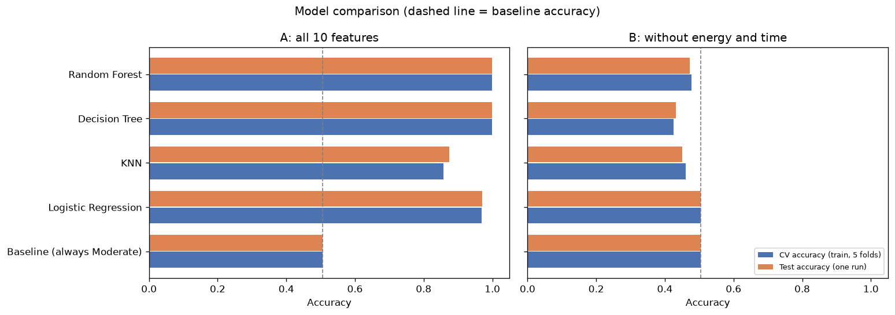
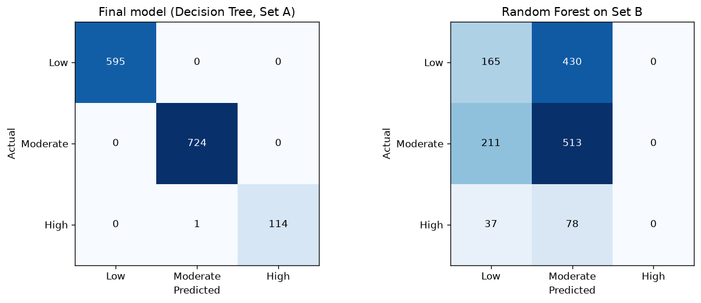
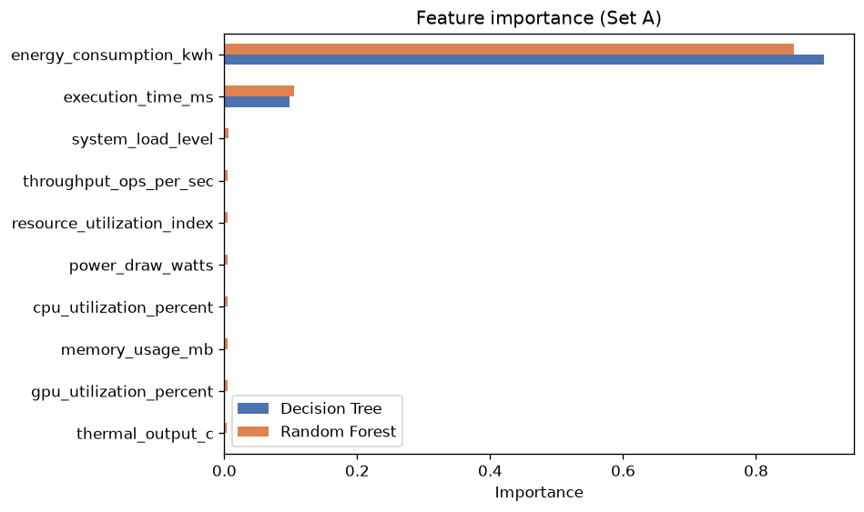
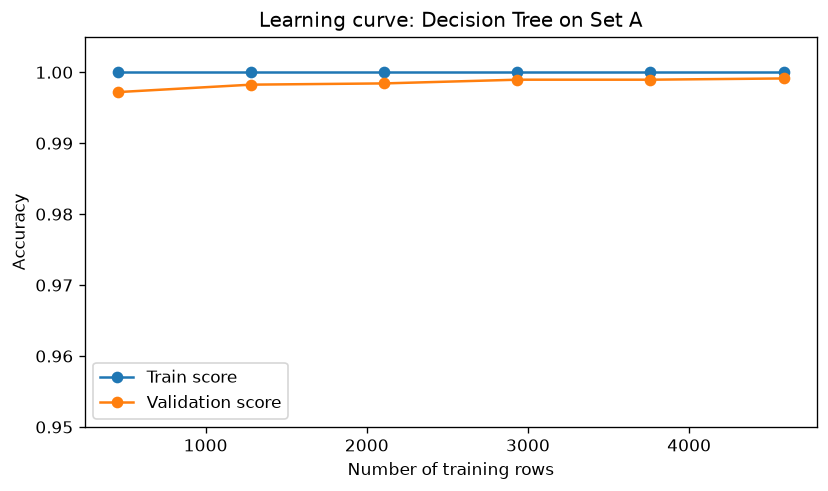

# Milestone 4: Modeling, Comparison and Results

## 1. Summary

We trained four models on the prepared data from Milestone 3 and compared them fairly: same split, same metrics, 5-fold cross validation on the
train set, and one final test score. Because Milestone 3 showed that the class follows a simple rule on two columns, we ran the comparison twice:
with all 10 features (Set A) and without `energy_consumption_kwh` and `execution_time_ms` (Set B).

- **Input:** [`../data/prepared`](../data/prepared) (5,733 train rows, 1,434 test rows, 10 scaled features)
- **Target variable:** `efficiency_class` (Low = 0, Moderate = 1, High = 2)
- **Notebook:** [`modeling_notebook.ipynb`](modeling_notebook.ipynb)
- **Extra experiment (feature engineering):** [`feature_engineering_experiment.py`](feature_engineering_experiment.py), output in [`feature_engineering_output.txt`](feature_engineering_output.txt)

## 2. Models and why we chose them

| Model | Why |
|---|---|
| Baseline (always predict Moderate) | Gives every score a reference point |
| Logistic Regression | Simple and explainable first model |
| KNN | Small clean dataset, and the data is already scaled |
| Decision Tree | Captures rules on a few columns and can be read like a flowchart |
| Random Forest | Usually the strongest raw performance |

## 3. How we compared them

Same train/test split for every model. Metrics: accuracy and **macro-F1** (High is only 8% of the data, so accuracy alone can hide a model that
ignores High). 5-fold stratified cross validation on the train set gives a stable score, and the test set is used once.

## 4. Results

**Set A: all 10 features**

| Model | CV accuracy | Test accuracy | Test macro-F1 | Test F1 (High) |
|---|---|---|---|---|
| Baseline | 0.505 | 0.505 | 0.224 | 0.000 |
| Logistic Regression | 0.969 | 0.971 | 0.935 | 0.838 |
| KNN | 0.858 | 0.874 | 0.818 | 0.670 |
| Decision Tree | 0.999 | 0.999 | 0.998 | 0.996 |
| Random Forest | 0.999 | 0.999 | 0.998 | 0.996 |

**Set B: without energy and time**

| Model | CV accuracy | Test accuracy | Test macro-F1 | Test F1 (High) |
|---|---|---|---|---|
| Baseline | 0.505 | 0.505 | 0.224 | 0.000 |
| Logistic Regression | 0.505 | 0.505 | 0.224 | 0.000 |
| KNN | 0.461 | 0.450 | 0.310 | 0.000 |
| Decision Tree | 0.426 | 0.432 | 0.342 | 0.107 |
| Random Forest | 0.478 | 0.473 | 0.305 | 0.000 |

## 5. Final model and why

**Decision Tree on all 10 features.** It ties with Random Forest (CV accuracy 0.9991 vs 0.9990, and the fold-to-fold spread is 0.001), so we chose the
simpler and fully explainable one. On the test set: accuracy 0.9993, macro-F1 0.9983, **1 wrong row out of 1,434**.

The tree has depth 3 and 4 leaves. Its splits are `energy_consumption_kwh` at 6.00 and 3.00, and `execution_time_ms` at 150.00. These are the same
limits we found by hand in Milestone 3.

| Figure | What it shows |
|---|---|
|  | Final model (left) and the Random Forest on Set B (right) |
|  | Energy and time carry almost all the importance |
|  | Train and validation scores are close, so no overfitting |

## 6. Challenges, limits and planned improvements

**Challenges**
1. The class is almost a rule on two columns, so the comparison on Set A cannot separate Decision Tree and Random Forest.
2. High is only 8% of the data. We report macro-F1 and the F1 of High next to accuracy.
3. Without energy and time, no model beats the baseline. A class-weight attempt did not fix it (accuracy fell to 0.32 and 0.38, High F1 stayed near 0.1).

**Limits of the final model**
- It recovers a rule. Its 99.9% mostly shows that the label was built from two columns.
- Energy and execution time are known only after a run, so the model cannot predict efficiency in advance.
- The High class has only 115 test rows, so any High score has a wide margin of error.

**Planned improvements**
1. Ask where `efficiency_class` came from. If it is a formula, say so in the project.
2. Look for features that cause energy use and run time (model size, batch size, hardware type).
3. Try a tuned Random Forest or gradient boosting on Set B once better features exist, with macro-F1 as the main metric.

## 7. Extra experiment: can feature engineering replace energy and time?

The coach asked whether new features, built without `energy_consumption_kwh` and `execution_time_ms`, can raise the accuracy. We built 8 features
from the 8 columns that are known before a run, each with a clear reason:

| New feature | Idea |
|---|---|
| `power_per_throughput` | Power for each operation per second |
| `cpu_gpu_total` | Total CPU + GPU load |
| `cpu_gpu_gap` | CPU load minus GPU load (balanced or not) |
| `heat_per_watt` | Heat produced per watt |
| `memory_per_throughput` | Memory needed per operation per second |
| `load_x_power` | System load times power draw |
| `power_per_util` | Power per unit of CPU + GPU use |
| `throughput_per_load` | Work done per unit of system load |

Results (baseline accuracy is 0.505):

- **Models:** the best test accuracy is 0.504 (Decision Tree, depth 4). Random Forest, gradient boosting and Logistic Regression stay at or below the baseline.
- **Mutual information with the class:** the best new feature scores 0.011, while `energy_consumption_kwh` scores 0.739.
- **Rebuilding the missing columns:** predicting energy from the other features gives R2 = -0.04, so energy cannot be recovered from them.

**Why it does not help:** the 8 pre-run columns are almost independent of each other (largest correlation 0.028, see Milestone 2), so mixing them does
not create new information.

**Limits of this experiment:** the settings were compared on the test set, so the best number is slightly optimistic, and it is still below the baseline.
It shows that ratios, sums, differences and products of these columns do not help. It does not prove that no other feature could.
The script reads the data only. It does not change any file in `data/`.

To run it: `python feature_engineering_experiment.py` (needs pandas, numpy and scikit-learn; takes about 1.5 minutes).
